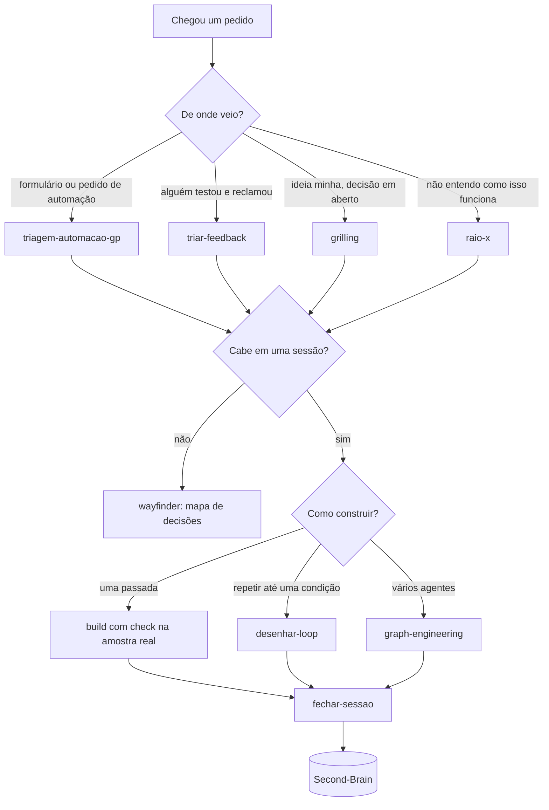

# Fluxo diário

Qual skill entra em cada momento do trabalho. É o índice para a pessoa:
as regras em [claude-config/regras.md](../../claude-config/regras.md)
dizem o mesmo para o agente.

## Por situação

| Situação | Skill | O que sai |
|---|---|---|
| Pedido de automação (formulário, e-mail, conversa) | `triagem-automacao-gp` | Mapa do processo, vereditos, plano com portões |
| Colaram conversa ou print de alguém que testou | `triar-feedback` | Item a item: versão antiga, bug, regra nova ou escopo; resposta pronta |
| Decisão em aberto antes de construir | `grilling` | Perguntas numeradas com resposta recomendada |
| Trabalho maior que uma sessão | `wayfinder` | Mapa de tickets de decisão |
| "Como isso funciona?" ou "como melhorar?" | `raio-x` | `RAIO-X.md`: regras, diagrama, pontos frágeis, melhorias |
| "Trabalha nisso até ficar pronto" | `desenhar-loop` | Condição de parada, motor, teto, portões humanos |
| Vários agentes, revisão cruzada, lote grande | `graph-engineering` | Tabela de nós e arestas e script do Workflow |
| Repositório sem instruções | `agents-md` | `AGENTS.md` e `CLAUDE.md` que o importa |
| Terminei | `fechar-sessao` | Entrega rodada, explicação, nota no vault |
| Preciso do conteúdo de um vídeo | `watch` | Transcrição e frames |
| Texto que outra pessoa vai ler | `humanizer` | O mesmo conteúdo, sem tiques de IA |
| Bug difícil | `diagnosing-bugs` | Laço de diagnóstico até teste de regressão |
| Funcionalidade com teste primeiro | `tdd` | Vermelho, verde, refatora |

## Comandos embutidos do Claude Code que valem o hábito

| Comando | Para quê |
|---|---|
| `/goal <condição>` | Trabalhar sozinho até a condição valer |
| `/loop [intervalo] <prompt>` | Acompanhar algo que muda sozinho |
| `/code-review` | Revisão do diff por um agente que não viu a conversa |
| `/verify` | Subir a aplicação e olhar o resultado |
| `/batch <mudança>` | A mesma mudança em muitos arquivos, em paralelo |
| `/clear` | Entre tarefas sem relação, para não pagar o histórico |
| `/doctor prompt-audit` | Achar instrução velha ou contraditória |
| `/usage` | Ver para onde foram os tokens |

Related: [inventario-skills](inventario-skills.md) ·
[como-trabalho](como-trabalho.md) · [00-Index](../../00-Index.md)
