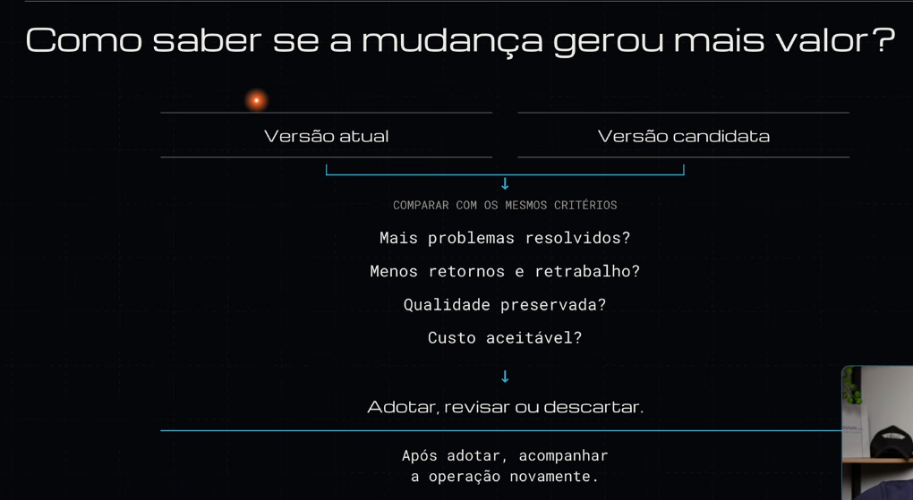

# Slide: RHAWK — Como saber se a mudança gerou mais valor?

Detalha a etapa **06 Avaliar e decidir** do [ciclo-de-evolucao-rhawk](../conceitos/ciclo-de-evolucao-rhawk.md).

## Pontos-chave
- Comparar a **versão atual** com a **versão candidata** usando **os mesmos critérios**.
- 4 critérios: mais problemas resolvidos · menos retornos e retrabalho · qualidade preservada · custo aceitável.
- 3 saídas: **adotar, revisar ou descartar**.
- Depois de adotar, **acompanhar a operação de novo**, o que fecha o ciclo em 01 Operar.

Análise: [avaliacao-atual-vs-candidata](../conceitos/avaliacao-atual-vs-candidata.md).
