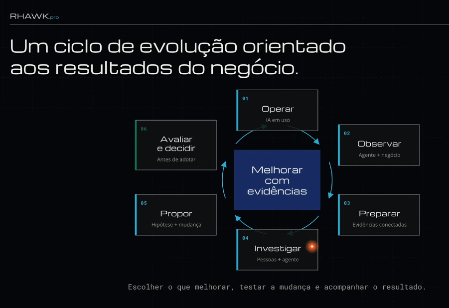

# Slide: RHAWK — Um ciclo de evolução orientado aos resultados do negócio

Ciclo de 6 etapas em volta de **"Melhorar com evidências"**:
**Operar → Observar → Preparar → Investigar → Propor → Avaliar e decidir** → Operar.

## O que é novo em relação ao resto do vault
- **A métrica é o negócio**, não o benchmark. "Observar" junta agente **+ negócio**. O [self-harness](../conceitos/self-harness.md) só olha o verificador técnico.
- **Preparar = evidências conectadas** é literalmente um [etl-agentico](../conceitos/etl-agentico.md) das evidências. Confirma a tese de [self-harness-como-etl](../sinteses/self-harness-como-etl.md).
- **Investigar com pessoas + agente**: o humano entra no diagnóstico, não só na aprovação. O Self-Harness faz tudo sozinho.
- **Avaliar e decidir antes de adotar** = [gate-de-regressao](../conceitos/gate-de-regressao.md) + [human-in-the-loop](../conceitos/human-in-the-loop.md).

Análise completa: [ciclo-de-evolucao-rhawk](../conceitos/ciclo-de-evolucao-rhawk.md).
