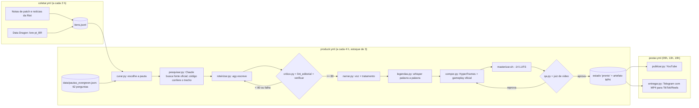

# Wardado Clips

> **Documentada em 18/11/2026.** Canal "dark" de curiosidades e notícias de League of Legends (YouTube Shorts, TikTok,
> Reels), produzido por uma esteira automática que roda no GitHub Actions. O texto é escrito e criticado pelo Claude,
> o vídeo é montado em HyperFrames e nada sai sem passar por quatro travas.
>
> - **Repositório:** `~/Projects/lol-dark` → github.com/buga2023/lol-dark (público, para ter Actions sem limite).
> - **Canal:** youtube.com/@wardadoclips (perfil configurado em 18/11).
> - **Nota de memória e decisões:** [lol-dark](../../memory/projects/lol-dark.md).
> - **Spec do dono:** `docs/SPEC.md` no repositório (versão 3).

## Arquitetura revisada (spec v5, 18/11/2026)

**Um modelo gera, outro fiscaliza.** O Antigravity CLI (`agy`, Gemini com o login do Ultra, sem chave de API) escreve o
rascunho do roteiro; o Claude Code orquestra e fiscaliza (pesquisa de fontes, crítico ≥ 80, nota editorial,
`verificar.py`, `qa.py`, juiz de vídeo, decisão de publicar). Coordenação local pelo [Orca](../guias/guia-orca-orquestracao.md).

| Papel | Agente | Onde |
| --- | --- | --- |
| Roteirista | `agy -p --output-format json` (modelo `gemini-4-carbon-high`) | `tools/llm.py` → `agy()`; testado em 18/11 (resposta em ~4 s) |
| Fiscal | Claude Code `claude -p` | crítico, nota editorial, pesquisa, juiz |
| Coordenação | Orca | worktree por agente (a montar) |

Consequência: o caminho principal passa a ser **a máquina do Gustavo ligada**, porque o `agy` usa o login em cache.
No GitHub Actions o roteirista cai para o Claude (`LOL_LLM_ESCRITOR=claude`). Gemini CLI foi encerrado para Pro/Ultra
em 18/06/2026 **(não verificado: fonte única citada na spec)**.

## Perguntas abertas

- Agentes remotos do Antigravity rodam com a máquina desligada? Seria o caminho para 24h.
- O Veo é acessível pelo `agy` ou só pelo Flow?
- Quantos vídeos por semana a cota do Ultra aguenta?
- Disco local com ~2 GB livres: a esteira local precisa de espaço antes de virar caminho principal.

## Como funciona, em uma figura

O estado (`itens.jsonl`, `pautas.jsonl`) vive no branch `state` do repositório; os MP4 ficam como artefatos do
Actions (30 dias), nunca no git.

## As peças

| Peça | O que faz | Detalhe que importa |
| --- | --- | --- |
| `tools/coletar.py` | Baixa notas de patch, notícias e lore | Deduplica por hash da URL; fonte fora do ar não derruba a coleta |
| `tools/curar.py` | Escolhe a pauta | Só o patch mais recente vira pauta; depois perenes em rodízio de série; não repete tema em 14 dias |
| `tools/pesquisar.py` | Responde pautas perenes | Claude com WebSearch só em domínios da Riot e na wiki oficial; o código baixa a página e exige o trecho literal |
| `tools/roteirizar.py` | Escreve o `roteiro.json` | Roteirista = `agy` (local) ou Claude (nuvem); prompt = skill `roteiro-short-lol` + rubrica do crítico; até 4 rodadas |
| `tools/critico.py` | Nota 0–100 e nota editorial 1–5 | Rubrica de 8 critérios (inclui antislop); crítico recebe a própria crítica anterior para não mudar de direção |
| `tools/lint_editorial.py` | Barra slop por código | Frases proibidas, cópia de 8+ palavras da fonte, gancho repetido |
| `tools/verificar.py` | Checagem de fatos | Todo número dito ou mostrado precisa existir no texto da fonte |
| `tools/narrar.py` | Voz por cena | VoiceStudio (OmniVoice) na nuvem, Kokoro `pf_dora` como reserva; tratamento de sala e pausas pela pontuação |
| `tools/legendas.py` | Tempo de cada palavra | Whisper local; o texto exibido é sempre o do roteiro |
| `tools/compor.py` | Monta o HTML e renderiza | Regras da skill `edicao-wardado`; gameplay oficial de cada habilidade (site da Riot) |
| `tools/masterizar.sh` | Mixagem final | De-esser, compressão, trilha com ducking, −14 LUFS e −1,5 dBTP |
| `tools/qa.py` | Travas técnicas | Formato, duração, volume, pico, loop de áudio, movimento a cada 2 s, loop visual, ocupação |
| `tools/qualidade.py` | Juiz de vídeo | Claude olha folhas de quadros (gancho e 9 amostras); nota ≥ 80 ou não publica |
| `tools/postar.py` | Publica no horário | Pega o pronto mais antigo do estoque |

## As quatro travas

1. **Fatos** (`verificar.py`): número sem fonte zera o roteiro.
2. **Texto** (`lint_editorial.py` + crítico ≥ 80 + nota editorial ≥ 4 em gancho, ângulo, clareza e fecho).
3. **Técnica** (`qa.py`): por exemplo, o vídeo do Azir passou com 0 de 17 janelas paradas, −14,1 LUFS e loop visual 0,835.
4. **Vídeo inteiro** (juiz por quadros): gancho, legibilidade, ritmo, acabamento, autenticidade.

Reprovou: refaz a etapa (até 3 voltas) ou não publica. "Não saiu vídeo hoje" é resultado válido.

## Identidade (skill `edicao-wardado`)

- Paleta: azul-naval `#0B3D6A`, azul-noite `#051C33`, ouro `#D1A147`, papel `#EDEAE4`; variações azul-ouro, noite-ouro, ouro-cheio.
- Tipos: Anton (títulos), JetBrains Mono (rótulos e números), Archivo 800 (legenda).
- Movimento seco: cortes, faixa dourada só na troca de bloco, `power3.out`, nada quica.
- Palco: gameplay oficial da habilidade citada alternando com detalhe da splash a cada ~1,8 s; o fecho termina no
  quadro exato em que o gancho começa (loop).
- Legenda em caixa azul-noite, palavra falada em ouro; marca d'água do olho no canto do palco.
- Sons fixos (Pixabay, uso comercial livre): corte, número, faixa, veredito, título.

## Skills do canal

| Skill | Papel |
| --- | --- |
| `wardado-canal` | Manual de operação: esteira, padrão de qualidade, publicação, quando parar |
| `roteiro-short-lol` | Como escrever o roteiro (ganchos, frases proibidas, checagem final) |
| `edicao-wardado` | Como o vídeo se parece e se move |
| `video-short-lol` | Como montar, renderizar, masterizar e validar |

Ficam em `.claude/skills/` no repositório e em `~/.claude/skills/` na máquina.

## Workflows (GitHub Actions)

| Workflow | Quando | O que faz |
| --- | --- | --- |
| `coletar.yml` | a cada 2 h | coleta e grava no branch `state` |
| `produzir.yml` | a cada 4 h | mantém 3 vídeos prontos; sobe VoiceStudio no runner |
| `postar.yml` | 09h, 13h, 19h (Salvador) | publica o pronto mais antigo |
| `aprovacao.yml` | a cada 30 min (modo aprovação) | lê os botões do Telegram |
| `testes.yml` | todo push | `pytest` (14 testes) |

Todos os que escrevem estado usam `concurrency: state`, e o push faz rebase com novas tentativas.

## Pendências (18/11/2026)

- Segredos: `CLAUDE_CODE_OAUTH_TOKEN` (`claude setup-token`), bot do Telegram, OAuth do YouTube.
- Auditoria da API do YouTube: sem ela todo upload automático fica privado.
- Voz definitiva com autorização por escrito (`assets/voz/referencia.wav`); hoje roda a reserva.
- Conflito registrado: a skill `wardado-canal` diz 4–5 vídeos/semana e modo aprovação; o dono pediu 3/dia automático.
- Imagens e vídeos gerados por IA (ex.: `agy`) ficam fora dos Shorts por regra das skills; só para peças fora do vídeo.

## Related

- [lol-dark (memória)](../../memory/projects/lol-dark.md)
- [guia-orca-orquestracao](../guias/guia-orca-orquestracao.md)
- [esteira-nti](esteira-nti.md)
